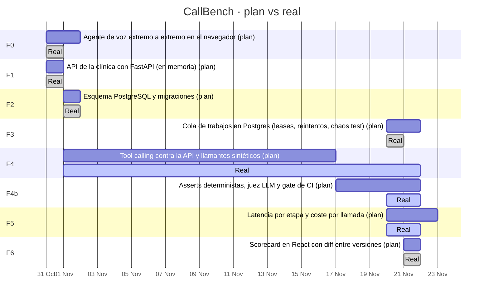

# CallBench · Gantt

> Generado por `tools/bitacora.py` desde `plan.toml` y `BITACORA.md`. No editar a mano.

**Objetivo:** Banco de regresión para agentes de voz Pipecat: llamadas sintéticas puntuadas y comparación entre versiones (éxito, latencia p50/p95, coste por llamada).

**Actualizado:** 2026-11-21 · **Avance:** 81 % · **Fase actual:** F4 Tool calling contra la API y llamantes sintéticos

| Fase | Nombre | Estado | Plan | Real | Entradas | Aviso |
|---|---|---|---|---|---|---|
| F0 | Agente de voz extremo a extremo en el navegador | ✅ hecho | 2026-10-31 → 2026-11-01 | 2026-10-31 → 2026-10-31 | 2 |  |
| F1 | API de la clínica con FastAPI (en memoria) | ✅ hecho | 2026-10-31 → 2026-10-31 | 2026-10-31 → 2026-10-31 | 1 |  |
| F2 | Esquema PostgreSQL y migraciones | ✅ hecho | 2026-11-01 → 2026-11-01 | 2026-11-01 → 2026-11-01 | 2 |  |
| F3 | Cola de trabajos en Postgres (leases, reintentos, chaos test) | ✅ hecho | 2026-11-20 → 2026-11-21 | 2026-11-20 → 2026-11-20 | 1 |  |
| F4 | Tool calling contra la API y llamantes sintéticos | 🔄 en_curso | 2026-11-01 → 2026-11-16 | 2026-11-01 → 2026-11-21 | 7 | retraso 5 d |
| F4b | Asserts deterministas, juez LLM y gate de CI | 🔄 en_curso | 2026-11-17 → 2026-11-21 | 2026-11-20 → 2026-11-21 | 1 |  |
| F5 | Latencia por etapa y coste por llamada | 🔄 en_curso | 2026-11-20 → 2026-11-22 | 2026-11-20 → 2026-11-21 | 1 |  |
| F6 | Scorecard en React con diff entre versiones | ✅ hecho | 2026-11-21 → 2026-11-21 | 2026-11-21 → 2026-11-21 | 1 |  |

## Últimas entradas de la bitácora

- 2026-11-21 · **F6** · Gate de regresión, API de resultados y scorecard React
- 2026-11-21 · **F4** · Guarda de confirmación en `reservar_cita`; v2 sin medir por cuota de Groq
- 2026-11-21 · **F4** · Línea base con asserts: 14/18 válidas y el juez aprobó las 4 que fallan
- 2026-11-20 · **META** · Unidas en main las ramas de cola, asserts, métricas+CI y guía
- 2026-11-20 · **META** · Documento "Cómo se hizo" para preparar la entrevista
- 2026-11-20 · **F3** · Resultados en Postgres y cola de trabajos con leases y reintentos
- 2026-11-20 · **F4b** · Asserts deterministas junto al juez LLM
- 2026-11-20 · **F5** · Métricas por llamada, coste y CI con pytest
