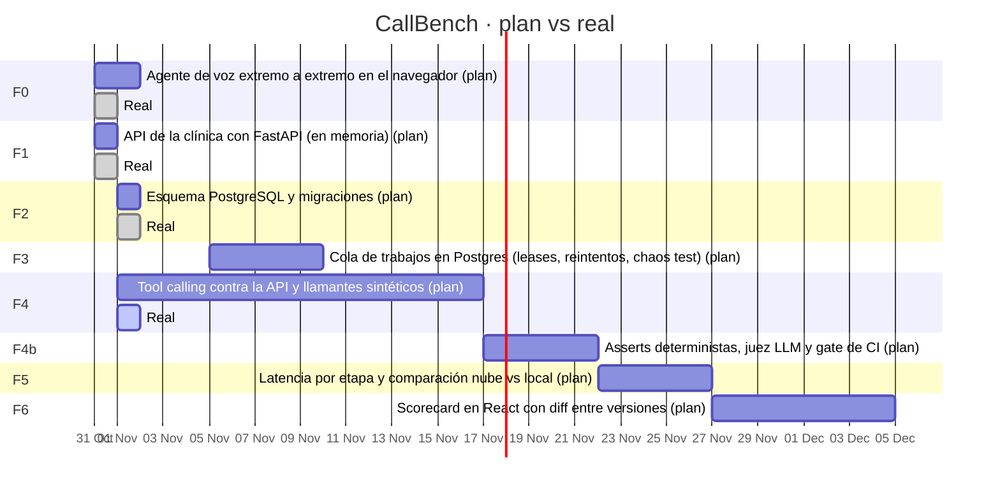

# CallBench · Gantt

> Generado por `tools/bitacora.py` desde `plan.toml` y `BITACORA.md`. No editar a mano.

**Objetivo:** Banco de regresión para agentes de voz Pipecat: llamadas sintéticas puntuadas y comparación entre versiones (éxito, latencia p50/p95, coste por llamada).

**Actualizado:** 2026-11-01 · **Avance:** 44 % · **Fase actual:** F4 Tool calling contra la API y llamantes sintéticos

| Fase | Nombre | Estado | Plan | Real | Entradas | Aviso |
|---|---|---|---|---|---|---|
| F0 | Agente de voz extremo a extremo en el navegador | ✅ hecho | 2026-10-31 → 2026-11-01 | 2026-10-31 → 2026-10-31 | 2 |  |
| F1 | API de la clínica con FastAPI (en memoria) | ✅ hecho | 2026-10-31 → 2026-10-31 | 2026-10-31 → 2026-10-31 | 1 |  |
| F2 | Esquema PostgreSQL y migraciones | ✅ hecho | 2026-11-01 → 2026-11-01 | 2026-11-01 → 2026-11-01 | 2 |  |
| F3 | Cola de trabajos en Postgres (leases, reintentos, chaos test) | ⏳ pendiente | 2026-11-05 → 2026-11-09 | — | 0 |  |
| F4 | Tool calling contra la API y llamantes sintéticos | 🔄 en_curso | 2026-11-01 → 2026-11-16 | 2026-11-01 → 2026-11-01 | 3 |  |
| F4b | Asserts deterministas, juez LLM y gate de CI | ⏳ pendiente | 2026-11-17 → 2026-11-21 | — | 0 |  |
| F5 | Latencia por etapa y comparación nube vs local | ⏳ pendiente | 2026-11-22 → 2026-11-26 | — | 0 |  |
| F6 | Scorecard en React con diff entre versiones | ⏳ pendiente | 2026-11-27 → 2026-12-04 | — | 0 |  |

## Últimas entradas de la bitácora

- 2026-11-01 · **F4** · Primer bucle medir → arreglar → medir
- 2026-11-01 · **META** · Publicado en GitHub
- 2026-11-01 · **META** · Preparación para publicar en GitHub
- 2026-11-01 · **F4** · Primeros exámenes con pipecat.evals
- 2026-11-01 · **F2** · Postgres portátil sin procesos huérfanos
- 2026-11-01 · **F2** · API sobre PostgreSQL portátil con migraciones
- 2026-11-01 · **F4** · Herramientas del agente: consultar huecos y reservar
- 2026-11-01 · **META** · Decisión sobre pipecat.evals
